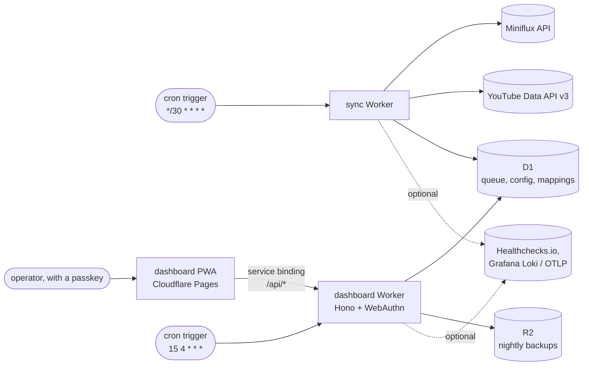
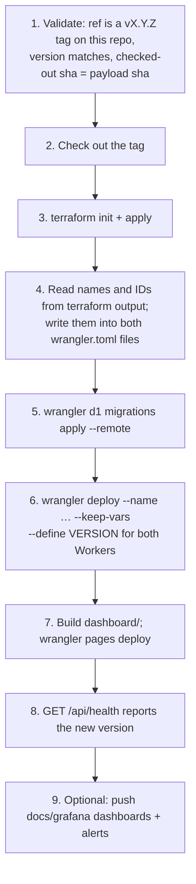
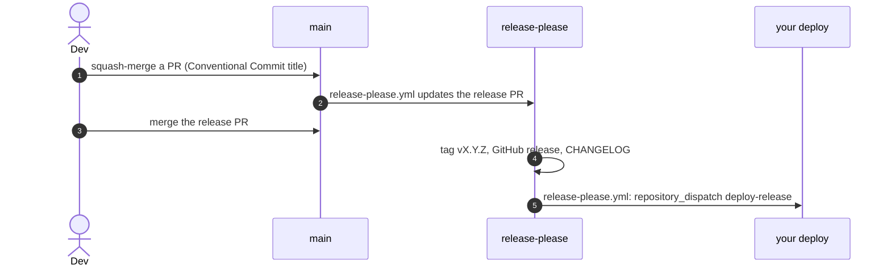

# FluxTube

FluxTube is a pair of Cloudflare Workers. They copy unread YouTube entries from [Miniflux](https://miniflux.app) into YouTube playlists, then mark the Miniflux entries as read once you have watched a video and removed it from the playlist. Since v1.0.0 there is also a passkey-protected dashboard (a PWA) for configuring it at runtime, and nightly backups to R2.

The goal is to keep YouTube as the place you watch (offline downloads, progress synced across devices) without copying RSS-discovered links into a playlist by hand.

This README is the manual: local development, every root script, and how to deploy your own instance. Update it in the same PR as any change to a script, a binding, a secret or a deploy step. `pnpm docs:check` fails CI when a root script is missing from it.

- [How it works](#how-it-works)
- [Architecture](#architecture)
- [Local development](#local-development)
- [Deploying your own instance](#deploying-your-own-instance)
- [Releases](#releases)
- [Observability](#observability)
- [CI](#ci)
- [Repo layout](#repo-layout)

## How it works

On each cron tick (every 30 minutes by default):

1. **Pass 1, add.** For each configured `(category, playlist)` pair, fetch the unread Miniflux entries. For every YouTube video that is not already in the playlist, call `playlistItems.insert` and record a row in D1.
2. **Pass 2, remove.** For each tracked row, check whether the video is still in its playlist. If you have removed it, mark the Miniflux entry read and delete the D1 row.

Pass 1 only adds and Pass 2 only removes. FluxTube never deletes from a playlist: you removing a video is the signal. [`docs/architecture.md`](./docs/architecture.md) covers the algorithm, the quota budget, dual-mode config, encryption at rest and backups.

## Architecture



| Resource                                                                                 | Created by                              | Notes                                                                                      |
| ---------------------------------------------------------------------------------------- | --------------------------------------- | ------------------------------------------------------------------------------------------ |
| D1 database, both Worker entities, cron triggers, R2 bucket and lifecycle, Pages project | Terraform (`infrastructure/terraform/`) | Every name is prefixed `fluxtube-<instance_id>`, so one account can host several instances |
| Worker code                                                                              | `wrangler deploy`                       | `--name` from `terraform output`; the committed names and IDs are placeholders             |
| Worker secrets                                                                           | `wrangler secret put`                   | Never in Terraform state                                                                   |
| D1 schema                                                                                | `wrangler d1 migrations apply`          | `workers/sync/migrations/`, applied before the code that needs them                        |
| Dashboard static site                                                                    | `wrangler pages deploy`                 | Bundles the `/api/*` Pages Function                                                        |

## Local development

Requirements: Node 22+ and pnpm 10+. Terraform 1.10+ is only needed to validate the IaC.

```sh
git clone https://github.com/alghanmi/fluxtube.git
cd fluxtube
pnpm install --frozen-lockfile
```

Root scripts, which run across every workspace:

| Script              | Does                                                                          |
| ------------------- | ----------------------------------------------------------------------------- |
| `pnpm test`         | vitest in every workspace (`@cloudflare/vitest-pool-workers` for the Workers) |
| `pnpm typecheck`    | `tsc --noEmit` in every workspace                                             |
| `pnpm lint`         | ESLint in every workspace                                                     |
| `pnpm format`       | Prettier `--write`                                                            |
| `pnpm format:check` | Prettier `--check`, as CI runs it                                             |
| `pnpm docs:check`   | Fail if this README misses a root script or has a broken link                 |

One workspace at a time:

```sh
pnpm --filter @fluxtube/sync test
pnpm --filter @fluxtube/dashboard test
pnpm --filter @fluxtube/sync test:watch
```

Running a Worker against real resources, or offline against a local D1, is covered in [`docs/setup.md`](./docs/setup.md). Both `wrangler.toml` files carry placeholders, so a local run needs your own gitignored copy.

## Deploying your own instance

Deployment happens outside this repository. Everything account-specific (the Cloudflare account and resource IDs, the R2 bucket names, API tokens, dashboard credentials) is supplied by you at deploy time; nothing here encodes a real value.

### What you need

- A Cloudflare account with Workers, D1, R2 and Pages, and an R2 bucket for Terraform state.
- A Miniflux instance, and YouTube playlists (`PL…`; Watch Later is not available through the API).
- A Google Cloud project with YouTube Data API v3 enabled, and an OAuth 2.0 _Web application_ client.
- A domain for the dashboard. It becomes the WebAuthn relying-party ID.
- Optionally: Healthchecks.io checks and a Grafana Cloud stack.

### Inputs and secrets

Terraform inputs are listed with placeholder values in [`terraform.tfvars.example`](./infrastructure/terraform/environments/production/terraform.tfvars.example). The backend is fully partial; [`backend.hcl.example`](./infrastructure/terraform/environments/production/backend.hcl.example) shows its shape.

Worker secrets, set with `wrangler secret put --name <worker>` on the Worker that reads them:

| Secret                                       | Read by   | Why                                                                                             |
| -------------------------------------------- | --------- | ----------------------------------------------------------------------------------------------- |
| `MINIFLUX_API_TOKEN`                         | sync      | Read entries and mark them read                                                                 |
| `YOUTUBE_CLIENT_ID`, `YOUTUBE_CLIENT_SECRET` | both      | OAuth token exchange (sync) and the dashboard's YouTube sign-in                                 |
| `YOUTUBE_REFRESH_TOKEN`                      | sync      | Only in env-managed mode; a claimed dashboard keeps it encrypted in D1                          |
| `MANUAL_TRIGGER_TOKEN`                       | both      | Bearer token for `POST /sync`, `GET /audit` and the `/api/*` operator routes                    |
| `D1_KEYCHAIN`                                | both      | `{ current, keys }` JSON for AES-GCM encryption of D1 columns. Must be the same on both Workers |
| `SESSION_SIGNING_KEY`                        | dashboard | HMAC key for session cookies                                                                    |
| `RP_ID`                                      | dashboard | WebAuthn relying-party ID: a registrable suffix of the dashboard host                           |
| `GRAFANA_LOKI_TOKEN`, `GRAFANA_OTLP_TOKEN`   | both      | Optional: log and metric push                                                                   |

Key rotation is in [`docs/encryption-keychain.md`](./docs/encryption-keychain.md).

### Deploying a release

Run these steps in order, for every release:



- **Step 4 is not optional.** `wrangler deploy` re-uploads bindings from `wrangler.toml`, and the committed D1 UUID, R2 bucket and Worker names are placeholders. Without `--name`, wrangler creates a stray Worker instead of updating yours.
- **Migrations go before the code** (step 5), so new code never runs against an old schema. They are idempotent, but they are not reversible.
- **Terraform owns the cron triggers.** Neither `wrangler.toml` declares `[triggers]`, and the `cron_enabled` / `dashboard_cron_enabled` variables are the kill switches.
- **Step 9** is `pnpm --filter @fluxtube/scripts sync-grafana`, with a Grafana API token in the environment. See [`docs/observability.md`](./docs/observability.md).

The same steps, with the reasoning for each, are in [`docs/architecture.md`](./docs/architecture.md#deploying-a-release).

### Automating it

When release-please cuts a release, `release-please.yml` itself sends a `repository_dispatch` of type `deploy-release` with `{ version, sha, actor, ref }`. It goes to the repository named in the `DEPLOY_TARGET_REPO` environment secret, authenticated with `DEPLOY_DISPATCH_TOKEN`. Point it at whatever runs the steps above, or leave both unset and deploy by hand. The dispatch is fired from that workflow because GitHub does not trigger other workflows for a release created with `GITHUB_TOKEN`. To re-send it for an existing tag, run **Notify deploy (manual)** (`notify-deploy.yml`) with the tag.

Scope `DEPLOY_DISPATCH_TOKEN` to firing dispatches at that repository and nothing else. With step 1 in place, a leaked token can only redeploy a release that already exists.

## Releases



The PR title is the release decision. `feat:` bumps the minor version, `fix:` the patch, and `feat!:` or `BREAKING CHANGE:` the major (FluxTube is on 1.x). `chore:`, `docs:`, `ci:`, `test:` and `refactor:` cut no release. Tooling and docs are never `feat:`.

## Observability

All four surfaces are optional; enable any subset.

| Surface                | What                                                   | Configure via                                                 |
| ---------------------- | ------------------------------------------------------ | ------------------------------------------------------------- |
| **stdout JSON logs**   | Always on; view with `wrangler tail`                   | —                                                             |
| **Healthchecks.io**    | Cron dead-man's switch, plus alerts per failure reason | `heartbeat_url`, `heartbeat_url_auth`, `heartbeat_url_quota`  |
| **Grafana Cloud Loki** | Structured log shipping                                | `grafana_loki_url`, `grafana_loki_user`, `GRAFANA_LOKI_TOKEN` |
| **Grafana Cloud OTLP** | Gauge metrics for each run, over OTLP/HTTP JSON        | `grafana_otlp_url`, `grafana_otlp_user`, `GRAFANA_OTLP_TOKEN` |

Every log line and metric carries `version` and `instance_id`, so one Grafana stack can serve several instances. [`docs/observability.md`](./docs/observability.md) has LogQL and PromQL recipes and the metric reference. The dashboards and alert rules are in `docs/grafana/`.

## CI

| Workflow              | Runs on                                 | Does                                                                          |
| --------------------- | --------------------------------------- | ----------------------------------------------------------------------------- |
| `pr-checks.yml`       | PR                                      | `pnpm docs:check`, Prettier check, typecheck, lint, test, build, `pnpm audit` |
| `terraform-check.yml` | PR touching `infrastructure/terraform/` | `terraform fmt -check` + `validate`, no credentials                           |
| `release-please.yml`  | push to `main`                          | Maintains the release PR; on a release, fires the deploy dispatch             |
| `notify-deploy.yml`   | manual, with a tag                      | Re-sends the deploy dispatch for an existing release                          |

CI holds no credentials beyond the dispatch token.

## Repo layout

```
.
├── workers/
│   ├── sync/                    # cron-driven sync Worker; migrations/ holds the D1 schema
│   └── dashboard/               # HTTP API Worker: Hono, WebAuthn, R2 backups
├── dashboard/                   # Astro PWA, served by Pages, calling the dashboard Worker
├── site/                        # marketing site (Astro)
├── infrastructure/terraform/    # module + production environment (partial backend)
├── docs/                        # architecture, setup, observability, encryption keychain
│   └── grafana/                 # dashboards and alert rules as JSON
├── scripts/                     # sync-grafana.ts, docs-check.sh
└── .github/workflows/           # see CI
```

## Contributing

PRs are welcome. Use Conventional Commit titles; see [Releases](#releases).

## License

MIT. See [`LICENSE`](./LICENSE).

## Security

See [`SECURITY.md`](./SECURITY.md) for the vulnerability disclosure policy.
